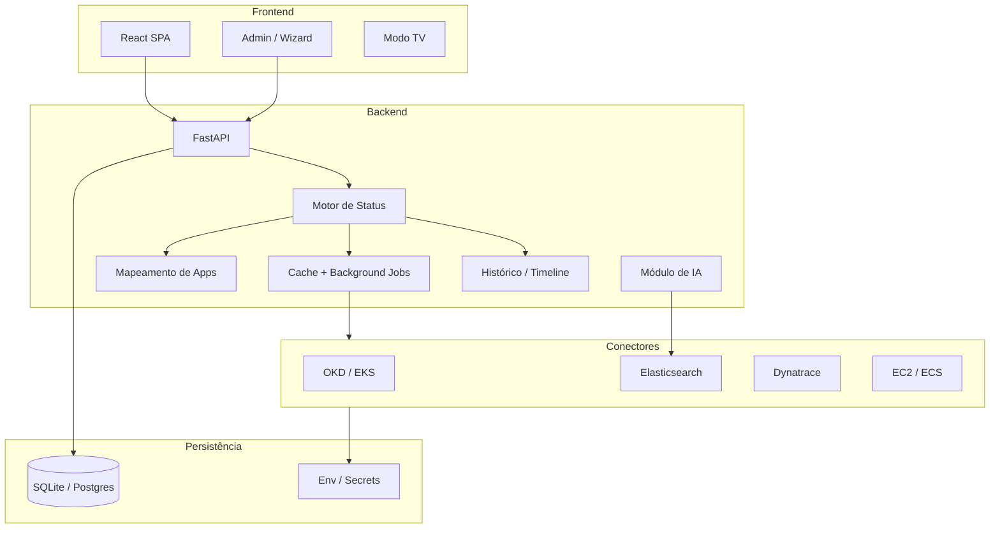

# Arquitetura Alvo — Olho da Providência

## Visão geral

## Princípios
- **Conectores plugáveis:** interface única `fetch_status(app) -> NormalizedStatus`.
- **Normalização:** todas as fontes produzem o mesmo modelo de status.
- **Resiliência:** timeout, retry com backoff, circuit breaker. Falha de uma fonte = estado "Desconhecido".
- **Cache + coleta em background:** o painel responde instantaneamente; coleta periódica.
- **Mapeamento explícito:** app é a unidade central. Recursos são vinculados via regras + correção manual.
- **Segredos fora do código:** apenas variáveis de ambiente / secrets.

## Modelo de dados normalizado (resumo)
- **App:** nome, ambiente, time, thresholds personalizados.
- **Resource:** tipo (pod, service, ec2, ecs, log-source, dynatrace-entity), identificador externo, app vinculada.
- **StatusSnapshot:** app, timestamp, overall_status, detalhes por fonte, fonte_indisponivel.
- **Event / Timeline:** mudança de status, incidente, insight de IA.

## Persistência
- **v1.0:** SQLite (simples, zero config).
- **Escala:** Postgres (quando necessário).

## Motor de status
Regras configuráveis por app (defaults sensatos):
- K8s: ready != desired → Warning/Critical
- ELK: erros > threshold/hora → Warning/Critical
- Dynatrace: problema aberto → Warning/Critical
- EC2/ECS: estado não running / desired != running → Warning/Critical
- Fonte indisponível → Desconhecido (não influencia o overall de forma silenciosa)

## Deep links
Gerador central que monta URLs filtradas:
- Kibana: Discover com query por service + time range
- Dynatrace: problema ou serviço
- AWS Console: instância ou serviço ECS
- OKD/EKS console: deployment/pods

## Decisões (ADRs curtas)
1. **Conectores plugáveis** — facilita adicionar novas fontes sem alterar o motor.
2. **SQLite inicial** — reduz fricção de deploy; migração para Postgres é planejada.
3. **Coleta em background** — evita timeouts no request path do painel.
4. **Mapeamento híbrido** — auto-descoberta + correção manual na UI.
5. **IA opcional e com controle de custo** — só dispara com erros relevantes + cache por assinatura.

## Próximos passos técnicos (Fase 1)
- Extrair interface de conector.
- Implementar circuit breaker e estado Desconhecido.
- Introduzir modelo de App + Resource + StatusSnapshot.
- Job de coleta periódica.
- Endpoints de admin para mapeamento e thresholds.
